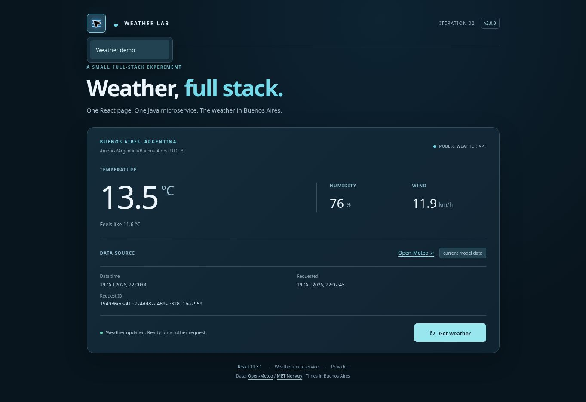
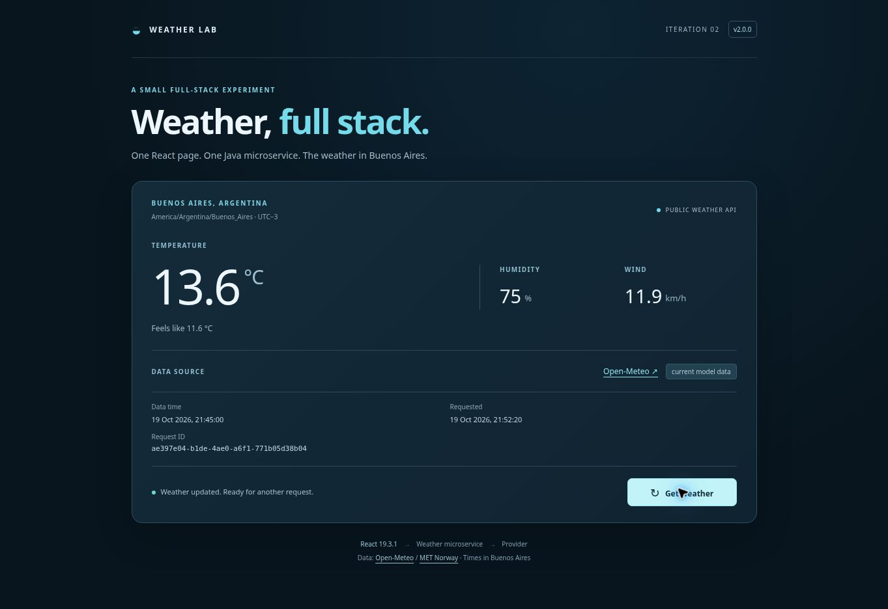

# Iteration 2 — release evidence

## Current frontend: single-option hamburger navigation

Original requirements, architecture and acceptance criteria were edited directly and published first in commit `9392be8c916699cb371aa558babf4ade040ca8a1`; no specification patch documents were introduced. Grounding in `specs/traceability.md` identifies the existing masthead, weather section and scoped button styles. Implementation commit: `cae61c61405d31e8f2b908de40a4093b45a2c7ce`.

Render frontend deployment `dep-dbbbt8mi0phs738be3lg` is live from that implementation commit, finished at `2026-10-20T01:07:06.109924Z`. The existing Java service continues to run its validated initial implementation; it required no changes. The stable branch `iteracion-2-v2.0.0-estable` remains at `bf018405eb8127dc47d3a651e44b7228393eccf1`.

- Frontend regression suite: 25 tests passed; production build passed.
- Live page: https://ariel-weather-iteration-2.onrender.com/
- Verified the initially closed Menu disclosure and its single English option, Weather demo.
- Keyboard Tab reaches the option; Escape closes the menu and restores focus to Menu.
- Selecting the option closes navigation and focuses #weather. Request ID remained `154936ee-4fc2-4dd8-a489-e328f1ba7959`, confirming preservation of the existing reading.
- Native fragment navigation and local React state implement this single-view application; no router or other runtime dependency was added.

See [navigation verification](evidence/navigation.json), [Render record](evidence/navigation-deployment.json) and [screenshot](evidence/navigation.jpg).

## Initial release: weather microservice and React page

Verified on 2026-10-20 UTC in the existing Render workspace.

## SDD provenance

1. [Specifications-only commit d41ef09988567cbcf63c1ead7462098fb0320d02](https://github.com/aribecker/0080-prueba-SDD-full-stack/commit/d41ef09988567cbcf63c1ead7462098fb0320d02): tree `5cfbd0c2ec3b1f71dd4f9062aa6bb4124615466c` contains only the four initial specification documents. Previous application files are absent.
2. [Implementation commit c435c37244eed72b589e56f1f371f1d96b066bcb](https://github.com/aribecker/0080-prueba-SDD-full-stack/commit/c435c37244eed72b589e56f1f371f1d96b066bcb): generated source, build configuration, tests, lockfile and requirement traceability. Tested local Git tree and published tree both equal `dce31e702374fa246c38b489af9549d9af1ee7fd`.
3. The initial documentation commit added acceptance evidence without changing either deployed component. Component build filters excluded those documentation-only paths.

## Live components

Both deployment records report status `live` and source commit `c435c37244eed72b589e56f1f371f1d96b066bcb`.

| Component | Public URL | Render service | Deployment |
| --- | --- | --- | --- |
| React static site | https://ariel-weather-iteration-2.onrender.com/ | srv-dbbblibbc2fs73ajnn20 | dep-dbbblirbc2fs73ajnrag |
| Java Free web service | https://ariel-weather-api-iteration-2.onrender.com/api/weather | srv-dbbblerbc2fs73ajn9l0 | dep-dbbblfbbc2fs73ajnco0 |

Frontend deployment finished at `2026-10-20T00:50:45.639626Z`; API deployment finished at `2026-10-20T00:51:54.387103Z`. See [deployment records](evidence/deployments.json).

The frontend build receives `VITE_WEATHER_API_URL=https://ariel-weather-api-iteration-2.onrender.com/api/weather`. Java CORS permits exactly `https://ariel-weather-iteration-2.onrender.com` and `http://localhost:5173`. The actual returned hostnames match `render.yaml`. Services were created through the Render API using that configuration; no Blueprint synchronization was enabled. Existing services and branches were left in place.

## Validation results

- Maven package: **14 tests passed**, zero failures/errors/skips; executable `weather-service-2.0.0.jar` produced.
- JAR smoke: actual Java process, health without provider calls, two successful HTTP weather requests with distinct IDs, CORS/no-store headers, then safe HTTP 502 on both fixture providers failing.
- Clean `npm ci`, `npm test`: **25 tests passed** across the HTTP client and React UI.
- `npm run build`: successful; React and react-dom exactly **19.3.1**, included in the bundle. The deployed UI displays actual `React.version` as 19.3.1.
- Render's Docker build reran all 14 Java tests and completed `BUILD SUCCESS`; the runtime started `/app/app.jar` with Java 17 and listened on port 8080.
- Render's static build reran all 25 client tests and built the production assets.
- Public `/health`: HTTP 200, `status=UP`, `version=2.0.0`, JSON and no-store.
- Public `/api/weather`: HTTP 200 with real Open-Meteo data, exact allowed CORS origin, exposed `X-Request-Id`, no-store and matching header/body ID. See [captured API response](evidence/public-api.json).

## Real browser interaction

The published React page stayed available while Java finished startup and displayed “Waking the weather service… retrying (attempt 2).” It then loaded real provider data automatically. The initial successful request used MET Norway and was explicitly labeled `nearest-hour forecast`.

- Initial request ID: `e14f5471-d5a9-4a79-98cb-665a29fd63fb`.
- Clicking **Get weather** cleared old values, disabled the button and made a new request.
- Refresh request ID: `ae397e04-b1de-4ae0-a6f1-771b05d38b04`, provider Open-Meteo, label `current model data`.
- Refreshed reading: 13.6 °C, feels like 11.6 °C, humidity 75%, wind 11.9 km/h. These are captured readings, not hard-coded application data.
- Desktop result area remained 198 px high and card 526 px high across loading and both successful provider states.
- No application console errors were observed; the browser extension emitted unrelated metadata errors.

See [browser evidence](evidence/browser.json) and the verified screenshot below. The fixture tests additionally cover unavailable providers, malformed data, retry limits, cancellation and obsolete lifecycle callbacks. A separate mobile-device session and a pixel comparison against the previous application were not performed. Docker was built and run by Render; no local Docker-engine build is claimed.

