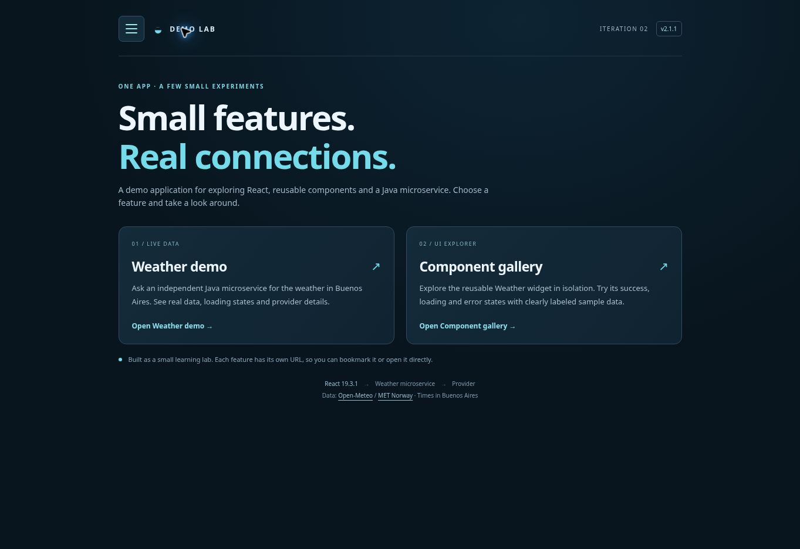
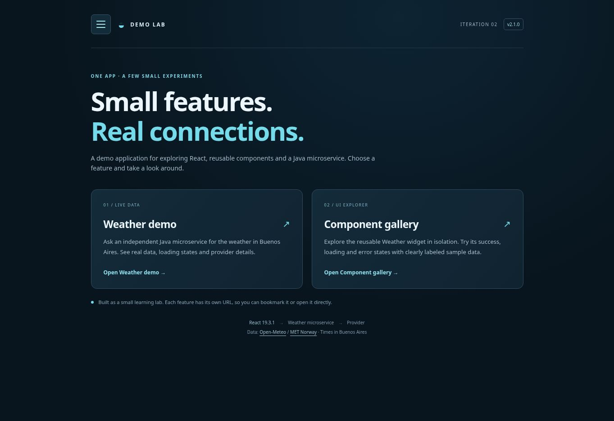

# Iteration 2 — release evidence

## Current frontend 2.1.1: compact vertical layout

Original specification R14, architecture and acceptance were updated first in `938505ec604a12ce68aa2ba73404bdc54ad559c4`. Grounding identifies existing shared shell, WeatherWidget, Home cards and gallery selectors. Implementation `1538a6a9b779d7db669506931e80088824266b7f` changes vertical spacing and the frontend patch version; font sizes and routing/weather logic are unchanged.

Render deployment `dep-dbbcfeuk1f9s73bn3rhg` is live, finished `2026-10-20T01:46:02.539915Z`. All 33 frontend regressions and the production build passed. Existing public URLs are unchanged.

Measured .page content height at the same **1363 × 936 desktop viewport**:
- Home: 779.4 → 709.4 px (**9.0% shorter**).
- Weather, loading state: 916.2 → 830.2 px (**9.4% shorter**).
- Gallery, success state: 1205.2 → 1100.2 px (**8.7% shorter**).

The mobile max-width:600px rules also reduce shell/intro margins, card padding, weather reserved heights, source rows, actions and gallery spacing while retaining text sizes. Menu remains 44 px high and the weather action was increased to 44 px. There was no horizontal overflow in the measured desktop viewport. No mobile viewport/device session was available for this check; exact phone percentages are not claimed. Natural wrapping and provider/error text can vary content height.

See [measurements](evidence/compact-layout.json), [deployment record](evidence/compact-deployment.json) and screenshot.

## Previous frontend 2.1.0: routed application and component gallery

Verified on 2026-10-20 UTC (19 October in Buenos Aires). The application now starts on an introduction; the existing live weather feature and new component gallery have their own React Router paths. The gallery uses the exact same WeatherWidget as the live page with explicit sample data and controlled Success/Loading/Error states.

### Checkpoint and SDD order

1. Before changing specifications or implementation, checkpoint commit `541da9ecf1af8ce14eabacad1ab67d100e6d0a16` preserved the verified single-page application. Git tag [v2.0.1](https://github.com/aribecker/0080-prueba-SDD-full-stack/releases/tag/v2.0.1) was created and its target independently verified. See [tag screenshot](evidence/checkpoint-v2.0.1.jpg).
2. Original requirements, architecture and acceptance criteria were edited directly and published in `7bde53b3b4257896b3d18b771d598c3cfb0a84bf`. No specification patch documents were introduced.
3. Grounding identifies the existing shell, card and useWeather ownership in specs/traceability.md. Implementation commit: `1233bd390fc97bd52afe2e38ca816fa804e32bc4`, exact tested/published tree `6258400fb2cf62e36090707782a9b45fccfb849a`.
4. This evidence-only follow-up does not affect the deployed bundle. The prior stable branch and v2.0.1 tag remain intact.

### Public routes

- Home: https://ariel-weather-iteration-2.onrender.com/
- Weather demo: https://ariel-weather-iteration-2.onrender.com/weather
- Component gallery: https://ariel-weather-iteration-2.onrender.com/components

Frontend Render service `srv-dbbblibbc2fs73ajnn20`, deployment `dep-dbbc6lflk1mc73dkfbcg`: **live**, source commit `1233bd390fc97bd52afe2e38ca816fa804e32bc4`, finished `2026-10-20T01:27:04.660006Z`. The Java service `srv-dbbblerbc2fs73ajn9l0` continues to run its validated API 2.0.0 implementation from `c435c37244eed72b589e56f1f371f1d96b066bcb`. No Java changes were needed. Frontend package/badge version is 2.1.0; API contract remains 2.0.0.

### Validation

- Clean npm ci, **33 frontend tests passed**, zero failures/skips, and production build passed. The prior 25 weather checks are retained; eight routing/gallery checks verify network isolation, lifecycle cancellation, active-route preservation, history, focus, gallery states and timer cleanup.
- React 19.3.1 and React Router 7.18.4 are pinned with the lockfile. BrowserRouter/Routes/NavLink supply path routing and history. Existing Render /* → /index.html rewrite supports fresh entry/reload without a new infrastructure service.
- Direct HTTP /, /weather and /components all return 200 with the same production app shell and JavaScript asset. The production bundle is reachable and contains the configured full API endpoint. Its hash differs from the local default-endpoint build because Render supplies VITE_WEATHER_API_URL at build time.
- Browser refresh verified on all three routes. Home shows the app introduction and two feature links. Browser Back/Forward, current-route marking, heading focus and keyboard Escape focus return verified.
- Gallery states Success/Loading/Error and local preview refresh verified. Preview card height stayed **526 px** in all three states at the desktop viewport. All example values are labeled SAMPLE DATA. The automated loader-isolation checks confirm no live request from Home or the gallery.
- /weather handled the real Render cold start and then displayed Open-Meteo data. Initial request ID `82db46dc-5fe1-4014-b11c-9294957ca37b`; manual refresh ID `98de449b-a3a7-48ed-b296-c145b4421982`. Selecting the already-active Weather demo menu link preserved that refreshed ID.
- Captured reading after refresh: 13.4 °C, feels like 11.4 °C, humidity 76%, wind 12.1 km/h. These are real captured provider values, not application fixtures.
- Public API health returns UP/version 2.0.0. No application console errors observed; unrelated browser-extension metadata errors were present. A separate mobile-device session was not performed.

See [browser evidence](evidence/routed-browser.json), [HTTP/bundle checks](evidence/routed-http.json), [deployment](evidence/routed-deployment.json), [API health](evidence/routed-api-health.json), [gallery capture](evidence/routed-gallery.jpg) and [live weather capture](evidence/routed-weather.jpg).

## Previous frontend: single-option hamburger navigation

Original requirements, architecture and acceptance criteria were edited directly and published first in commit `9392be8c916699cb371aa558babf4ade040ca8a1`; no specification patch documents were introduced. Grounding in `specs/traceability.md` identifies the existing masthead, weather section and scoped button styles. Implementation commit: `cae61c61405d31e8f2b908de40a4093b45a2c7ce`.

Render frontend deployment `dep-dbbbt8mi0phs738be3lg` is live from that implementation commit, finished at `2026-10-20T01:07:06.109924Z`. The existing Java service continues to run its validated initial implementation; it required no changes. The stable branch `iteracion-2-v2.0.0-estable` remains at `bf018405eb8127dc47d3a651e44b7228393eccf1`.

- Frontend regression suite: 25 tests passed; production build passed.
- Live page: https://ariel-weather-iteration-2.onrender.com/
- Verified the initially closed Menu disclosure and its single English option, Weather demo.
- Keyboard Tab reaches the option; Escape closes the menu and restores focus to Menu.
- Selecting the option closes navigation and focuses #weather. Request ID remained `154936ee-4fc2-4dd8-a489-e328f1ba7959`, confirming preservation of the existing reading.
- Native fragment navigation and local React state implement this single-view application; no router or other runtime dependency was added.

See [navigation verification](evidence/navigation.json), [Render record](evidence/navigation-deployment.json) and [screenshot](evidence/navigation.jpg).

## Initial release: weather microservice and React page

Verified on 2026-10-20 UTC in the existing Render workspace.

## SDD provenance

1. [Specifications-only commit d41ef09988567cbcf63c1ead7462098fb0320d02](https://github.com/aribecker/0080-prueba-SDD-full-stack/commit/d41ef09988567cbcf63c1ead7462098fb0320d02): tree `5cfbd0c2ec3b1f71dd4f9062aa6bb4124615466c` contains only the four initial specification documents. Previous application files are absent.
2. [Implementation commit c435c37244eed72b589e56f1f371f1d96b066bcb](https://github.com/aribecker/0080-prueba-SDD-full-stack/commit/c435c37244eed72b589e56f1f371f1d96b066bcb): generated source, build configuration, tests, lockfile and requirement traceability. Tested local Git tree and published tree both equal `dce31e702374fa246c38b489af9549d9af1ee7fd`.
3. The initial documentation commit added acceptance evidence without changing either deployed component. Component build filters excluded those documentation-only paths.

## Live components

Both deployment records report status `live` and source commit `c435c37244eed72b589e56f1f371f1d96b066bcb`.

| Component | Public URL | Render service | Deployment |
| --- | --- | --- | --- |
| React static site | https://ariel-weather-iteration-2.onrender.com/ | srv-dbbblibbc2fs73ajnn20 | dep-dbbblirbc2fs73ajnrag |
| Java Free web service | https://ariel-weather-api-iteration-2.onrender.com/api/weather | srv-dbbblerbc2fs73ajn9l0 | dep-dbbblfbbc2fs73ajnco0 |

Frontend deployment finished at `2026-10-20T00:50:45.639626Z`; API deployment finished at `2026-10-20T00:51:54.387103Z`. See [deployment records](evidence/deployments.json).

The frontend build receives `VITE_WEATHER_API_URL=https://ariel-weather-api-iteration-2.onrender.com/api/weather`. Java CORS permits exactly `https://ariel-weather-iteration-2.onrender.com` and `http://localhost:5173`. The actual returned hostnames match `render.yaml`. Services were created through the Render API using that configuration; no Blueprint synchronization was enabled. Existing services and branches were left in place.

## Validation results

- Maven package: **14 tests passed**, zero failures/errors/skips; executable `weather-service-2.0.0.jar` produced.
- JAR smoke: actual Java process, health without provider calls, two successful HTTP weather requests with distinct IDs, CORS/no-store headers, then safe HTTP 502 on both fixture providers failing.
- Clean `npm ci`, `npm test`: **25 tests passed** across the HTTP client and React UI.
- `npm run build`: successful; React and react-dom exactly **19.3.1**, included in the bundle. The deployed UI displays actual `React.version` as 19.3.1.
- Render's Docker build reran all 14 Java tests and completed `BUILD SUCCESS`; the runtime started `/app/app.jar` with Java 17 and listened on port 8080.
- Render's static build reran all 25 client tests and built the production assets.
- Public `/health`: HTTP 200, `status=UP`, `version=2.0.0`, JSON and no-store.
- Public `/api/weather`: HTTP 200 with real Open-Meteo data, exact allowed CORS origin, exposed `X-Request-Id`, no-store and matching header/body ID. See [captured API response](evidence/public-api.json).

## Real browser interaction

The published React page stayed available while Java finished startup and displayed “Waking the weather service… retrying (attempt 2).” It then loaded real provider data automatically. The initial successful request used MET Norway and was explicitly labeled `nearest-hour forecast`.

- Initial request ID: `e14f5471-d5a9-4a79-98cb-665a29fd63fb`.
- Clicking **Get weather** cleared old values, disabled the button and made a new request.
- Refresh request ID: `ae397e04-b1de-4ae0-a6f1-771b05d38b04`, provider Open-Meteo, label `current model data`.
- Refreshed reading: 13.6 °C, feels like 11.6 °C, humidity 75%, wind 11.9 km/h. These are captured readings, not hard-coded application data.
- Desktop result area remained 198 px high and card 526 px high across loading and both successful provider states.
- No application console errors were observed; the browser extension emitted unrelated metadata errors.

See [browser evidence](evidence/browser.json) and the verified screenshot below. The fixture tests additionally cover unavailable providers, malformed data, retry limits, cancellation and obsolete lifecycle callbacks. A separate mobile-device session and a pixel comparison against the previous application were not performed. Docker was built and run by Render; no local Docker-engine build is claimed.

## Login v2.2.0 (R15–R18)
Specifications committed first as 38901ca778517faa2de6d79afe1944bc69b51b08. Existing shell/Home/router are extended by /login; authentication is implemented in the existing Java API. Three providers are supported with optional server-only client registrations. The no-credential deployment is intentional: no fabricated profiles or active buttons for an unconfigured provider.

Validation: React 42/42 tests and Vite production build pass; Java 23/23 tests and Maven package pass. Executable-JAR smoke reports health UP, real HTTP weather fixture 200 twice, unique request IDs, exact-origin CORS and structured 502 provider failure. Auth tests cover provider-unconfigured startup, state/PKCE redirect construction, invalid callback state, single-use browser-bound exchange, expiry, revocation, missing attributes and foreign-origin rejection. Real provider token exchange/consent is not claimed until the owner's credentials are configured.

Session tradeoffs: a bounded single-instance memory store, 60-second handoff, 30-minute demo session in sessionStorage, sessions invalidated by backend restart, no linked-user database. Provider tokens are discarded after userinfo. See docs/login-setup.md for exact callbacks and activation.
